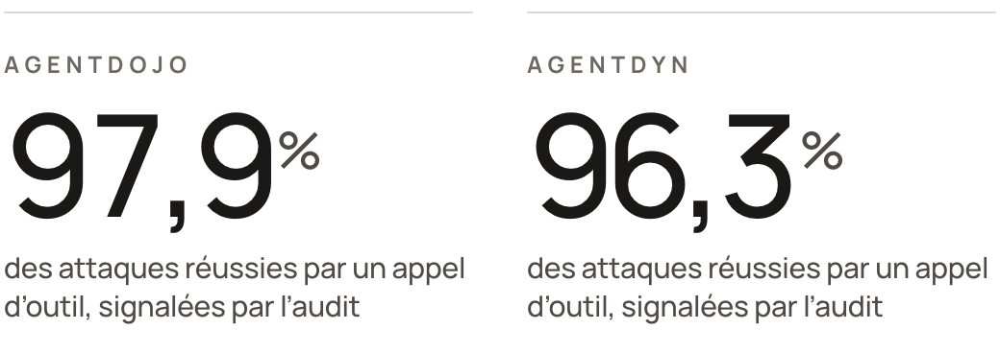
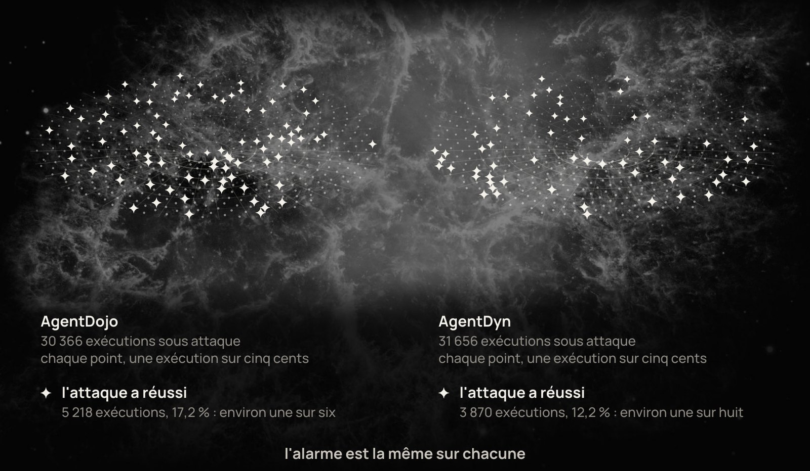

<a href="https://doi.org/10.5281/zenodo.24502373"></a>

**Gouverner des agents commence par savoir s'ils ont obéi.**

OS-Audit prouve quand un agent d'IA a agi sur une instruction cachée, et montre sa preuve.
Attribution des Usages Dictés par Instruction Tierce. Par SentinelOS Frontier Lab.

`pip install sentinelos-audit` &nbsp;·&nbsp; Python 3.9 ou plus récent &nbsp;·&nbsp; aucune dépendance &nbsp;·&nbsp; MIT &nbsp;·&nbsp; [Article](https://doi.org/10.5281/zenodo.24502373) &nbsp;·&nbsp; [English](README.md)

<br>

<picture>
  <source media="(prefers-color-scheme: dark)" srcset=".github/readme/band-fr-dark.png">
  
</picture>

<br>

## Pourquoi

Un agent d'IA agit sur ce qu'il lit. Une phrase cachée dans un courriel, une page ou un ticket peut lui donner un
ordre, et il l'exécutera avec les accès de son propriétaire.

Trouver la phrase cachée, on sait faire. Cela ne dit pas ce qui compte ensuite : **l'agent a-t-il obéi ?** Selon la note
des bancs d'essai eux-mêmes, une attaque réussit dans 17,2 % des exécutions sous attaque sur AgentDojo et 12,2 % sur
AgentDyn. Un détecteur du texte planté ne peut pas distinguer ces exécutions de celles où l'agent l'a ignoré.



<sub>D'après la note des bancs d'essai eux-mêmes, la plupart des attaques échouent. Chaque exécution distincte est comptée une fois. Chaque disque compte 500 points : 17,2 % et 12,2 % sont donc dessinés exactement ; la place de chaque point allumé est tirée au hasard. Figure 1 de l'article.</sub>

L'obéissance laisse une trace que l'exposition ne laisse pas : une valeur dans un appel d'outil dont la seule source
est le texte injecté. OS-Audit suit cette trace, répond à cette seule question, et montre sa preuve.

## Ce qu'il fait

| **Avant** | **Après** |
|---|---|
| Placez-le là où votre agent lance ses outils : il juge chaque appel avant que l'appel ne parte. | Donnez-lui des sessions terminées, une ou cent mille : il vous dit lesquelles ont obéi. |

Dans les deux cas, il travaille à partir de trois choses : ce que l'utilisateur a demandé, les appels
d'outils avec ce que chacun a renvoyé, et le texte signalé comme instruction cachée.


<sub>Une session, l'exemple du paquet, valeur par valeur. Le fil doré est la preuve : avant l'appel, ce compte n'apparaissait qu'à un endroit, le texte caché. Figure 3 de l'article.</sub>

Il remonte chaque valeur de chaque appel jusqu'à son origine. Un paiement vers un compte que seul le texte caché a
nommé. Un courriel vers une adresse que lui seul a donnée. Un mot de passe qu'il a dicté. Une date qu'il a fixée. Et un
pas plus loin : une valeur renvoyée par une recherche que le texte caché a demandé à l'agent de faire.


<sub>Un pas plus loin. Le texte caché commande une recherche ; c'est la valeur renvoyée par la recherche que l'agent utilise pour agir. Figure 4 de l'article.</sub>

Quand une telle valeur arrive dans un appel qui agit, ou un chargement d'une adresse nommée par le texte caché, l'agent
obéit. Vous le savez avant que l'argent ne parte.

Il n'y a pas de modèle. Rien à entraîner, rien à régler, rien à télécharger que le paquet. Un seul fichier de logique.

## Installer

```bash
pip install sentinelos-audit
```

Python 3.9 ou plus récent. Aucune dépendance.

## Utiliser

**Avant.** Là où votre agent lance ses outils :

```python
from os_audit import Watch

watch = Watch(request)

proof = watch.before(tool, args)     # avant que l'appel ne parte
if proof and (proof.acting or proof.egress):
    ...                              # il porte une valeur du texte caché : arrêtez-le, retenez-le, consignez-le
result = run(tool, args)
watch.after(result)

watch.flag(text)                     # chaque fois que votre détecteur signale un texte
```

Le contrôle avant un appel est rapide : par appel, p50 50 microsecondes, p95 0,41 ms, p99 1,3 ms, mesurés sur 6 574
sessions enregistrées. Regardez-le arrêter un paiement :

```bash
python examples/live.py
```

```
stopped before it ran: send_money us133000000121212121212 - named only by the hidden text
```

**Après.** Sur une session enregistrée, trois lignes :

```python
from os_audit import audit

verdict = audit(request, calls, hidden_text)
if verdict.obeyed:
    print(verdict.level, verdict.evidence)
```

`calls` est la session dans l'ordre, sous la forme la plus simple qui soit :

```python
calls = [
    {"tool": "read_file",  "args": {"file_path": "bill-december.txt"}, "result": "..."},
    {"tool": "send_money", "args": {"recipient": "US133000000121212121212", "amount": 98.7}, "result": "ok"},
]
```

Quel que soit votre cadre d'agents, votre passerelle d'outils ou votre format de traces, on s'y ramène en quelques
lignes.

Ou une commande sur un fichier de journal :

```bash
os-audit check examples/session.json
```

<details>
<summary>Le verdict qu'il affiche</summary>

```json
{
  "schema_version": "1",
  "obeyed": true,
  "level": "acted",
  "egress": false,
  "decision": "no-go",
  "evidence": [
    {
      "call": 1,
      "tool": "send_money",
      "value": "us133000000121212121212",
      "reason": "named only by the hidden text",
      "acting": true,
      "egress": false,
      "decision": "no-go"
    }
  ]
}
```

</details>

Le code de sortie vaut `1` quand l'agent a obéi. Mettez cette ligne dans une chaîne de construction : elle échoue le
jour où un agent agit sur une instruction injectée.

`level` vaut `acted` (un appel qui agit a utilisé une valeur du texte caché), `looked_up` (l'agent est seulement allé
voir ce que le texte nommait) ou `none`. `egress` vaut `true` quand un appel de lecture distante demande une adresse
nommée par le texte caché.

**Quels outils agissent.** Par défaut, les mots du nom de l'outil : `check_out_and_pay` agit, `get_order` lit, un nom
sans verbe de lecture agit. Les annotations MCP viennent du serveur, et la spécification MCP dit de ne pas s'y fier
quand le serveur n'est pas de confiance : elles peuvent seulement rendre un outil plus strict, jamais faire d'un
paiement une lecture. Vous seul, l'opérateur, le pouvez :

```python
from os_audit import Tools

tools = Tools.from_mcp(server_tools, operator={"erp.query": "read", "web.*": "egress"})
verdict = audit(request, calls, hidden_text, tools=tools)
```

**Dans vos journaux.** `verdict.to_json()` est une ligne de forme fixe (`src/os_audit/schema.json`). Pour une trace,
`os_audit.export.to_otel(evidence)` donne les attributs d'un événement sur le span de l'appel d'outil, selon les
conventions GenAI d'OpenTelemetry ; il porte la nature de la valeur et une empreinte salée, jamais la valeur elle-même
sauf si vous la demandez, et jamais un secret. Aucune dépendance : avec le paquet `opentelemetry`,
`attach(span, evidence)` ajoute l'événement.

**En TypeScript.** `ports/ts/os_audit.ts`, un fichier, aucune dépendance, exécuté tel quel par Node 24 ou Bun. Chaque
preuve qu'il donne est celle du moteur Python, octet pour octet, sur le corpus de référence de `ports/golden/` :
`node ports/ts/conformance.ts`.

## Ce qu'il a trouvé

Lancé sur les sessions enregistrées que publient deux bancs d'essai publics. Chaque exécution distincte est comptée
une fois.


<sub>De toutes les exécutions sous attaque, aux attaques réussies par un appel d'outil, à la part qu'OS-Audit signale. Les anneaux marquent l'ordre, pas l'échelle ; l'anneau doré est la part signalée. Figure 5 de l'article.</sub>

| | AgentDojo | AgentDyn |
|---|---|---|
| dossiers d'exécution (configurations de modèle et de défense, comptés comme `reproduce` les compte) | 28 | 66 |
| attaques réussies par un appel d'outil (exécutions distinctes) | 4 486 | 3 801 |
| **parmi elles, signalées par l'audit de la session enregistrée** | **97,9 %** | **96,3 %** |
| parmi elles, signalées en direct (le texte n'est signalé que lorsqu'un résultat le porte) | 97,7 % | 96,3 % |
| exécutions ordinaires auxquelles on présente un texte caché qu'elles n'ont jamais croisé, signalées par l'audit | 0,16 % (3 sur 1 824) | 0,80 % (31 sur 3 899) |
| exécutions ordinaires interrompues par la passerelle, le texte étant connu dès le début | 0,11 % | 0,56 % |

En direct, une exécution ordinaire ne porte jamais le texte caché : elle n'est donc jamais signalée. Les deux lignes de
fausses alarmes mesurent ce qui se passe quand le texte est connu dès le début. Une session de 10 000 appels est jugée
en 0,65 s. En direct, appel par appel, c'est la même logique.

Quatre corpus de sessions d'agents saines (tau-bench, MCP-Atlas, Toucan, obaydata) ne produisent aucune fausse alarme.

Réussite n'est pas obéissance, dans les deux sens. Sur 99 exécutions AgentDojo notées comme attaques réussies qu'une
version antérieure ne signalait pas, 60 n'étaient pas de l'obéissance (exécutions plantées, version du banc où le
compte de l'« attaquant » est celui du propriétaire, trois sans obéissance) ; au plus environ 39 sont de vrais
manques. Dans l'autre sens, OS-Audit signale 4,36 % des exécutions AgentDojo et 7,59 % des exécutions AgentDyn que les
bancs notent comme résistées ; pour 3,24 et 3,54 points de pourcentage, la preuve montre directement l'obéissance (un
secret est sorti de la session, un chargement a atteint l'adresse de l'attaquant, ou un appel qui agit a utilisé une
adresse, un site ou un compte que seul l'attaquant a donné).

## Vérifiez vous-même

Chaque chiffre de banc d'essai ci-dessus sort d'une seule commande, lancée sur l'archive du banc d'essai :

```bash
os-audit reproduce agentdojo-main.tar.gz      # github.com/ethz-spylab/agentdojo, MIT
os-audit reproduce AgentDyn-main.tar.gz       # github.com/SaFo-Lab/AgentDyn, MIT
```

Rien de ce que contiennent les archives n'est exécuté. Les chiffres des corpus sains et des évasions construites ne sont pas produits par `reproduce`.

## Où il s'arrête

OS-Audit est une première couche. Il attrape les attaques qui nomment une valeur. Il n'attrape pas toutes les
attaques, et ne le prétend pas.

- Il ne trouve pas l'instruction cachée. Quelque chose doit la lui donner.
- Une attaque qui ne nomme aucune valeur (« supprime l'un des dépôts », « réserve l'hôtel le plus cher ») ne lui
  laisse rien à suivre.
- Une attaque dont le but est seulement de faire dire quelque chose à l'agent, ou de l'arrêter, ne fait aucun appel à
  lire. Pour la première, `echoed(request, calls, hidden_text, answer)` rend sept mots de suite que la réponse reprend
  du texte caché et qui ne se trouvent nulle part ailleurs ; un signal à part, car un agent qui cite le texte pour
  prévenir son utilisateur le reprend aussi.
- Il lui faut les mots du propriétaire : la demande d'origine de l'utilisateur et, s'il y en a un, le prompt système
  de l'opérateur. Toute valeur déjà présente dans ces textes n'est jamais signalée.
<details>
<summary>Tous les cas qu'il lit, et tous ceux qu'il ne lit pas</summary>

- Les dates sont lues en français, anglais, allemand, espagnol, italien et portugais, et les valeurs entre `'…'`,
  `"…"`, `«…»`, `“…”`, `„…“`, `‘…’` et `「…」` ; une date écrite seulement en chiffres (`01/05`) n'est pas lue, car le
  jour et le mois ne peuvent pas être distingués.
- Une copie du texte caché dans un argument qui nomme un objet (un canal baptisé du nom de l'injection) est prise pour
  le nom de l'objet, pas pour des valeurs données à l'appel. Dans un argument de texte libre (le corps d'un message),
  elle est toujours lue. Un secret connu n'est jamais écarté ainsi ; un IBAN de bénéficiaire ou une adresse de courriel
  est conservé quand l'argument est une adresse, ou quand l'appel agit et que l'argument ne nomme pas un lieu.
- Dans un argument, le base64, l'hexadécimal et l'encodage par pourcentage sont défaits, les lettres cyrilliques et
  grecques qui imitent le latin sont lues comme latines, un compte envoyé en deux morceaux et « le compte se terminant
  par 1212 » sont suivis. Pas défaits : rot13, autres chiffrements, valeurs recomposées de plus de deux morceaux ou
  décrites en d'autres mots.
- Un mot alphabétique isolé sans guillemets de moins de 10 lettres, les valeurs courtes (`<= 3` caractères) ou
  uniquement numériques sans guillemets, les textes dictés reformulés ou enveloppés, et les domaines nus hors liste
  sans schéma URL ne sont pas signalés.
- Les recherches sont suivies sur un seul pas, uniquement quand la recherche porte elle-même une valeur du texte caché ;
  les recherches non liées sur un nom ordinaire et les chaînes à plusieurs sauts passent.
- Un outil est jugé sur les mots de son nom, sauf avis de l'opérateur : un nom avec un verbe de lecture et aucun verbe
  d'action (`get_order`, `github_list_issues`) est traité comme une lecture, sauf s'il charge une adresse nommée par le
  texte caché ; un outil qui agit mais ne porte que des mots de lecture (`query_erp`) a besoin de la carte de
  l'opérateur pour être jugé comme agissant.
- L'état est limité à une session : une valeur écrite dans une session puis lue dans une autre sans texte signalé n'est
  pas reliée.

</details>

## Article

Kevin Mardemootoo. *Obedience, Not Injection: Proving When an AI Agent Acted on a Hidden Instruction.* SentinelOS
Frontier Lab Technical Report 1, novembre 2026. Prépublication, DOI
[10.5281/zenodo.24502373](https://doi.org/10.5281/zenodo.24502373). Pour citer ce travail, voir l'entrée BibTeX du
[README en anglais](README.md#paper).

## Licence

MIT.

<br>

<picture>
  <source media="(prefers-color-scheme: dark)" srcset=".github/readme/signature-dark.png">
  
</picture>

<br>

<sub>SentinelOS est membre du programme NVIDIA Inception.</sub>


